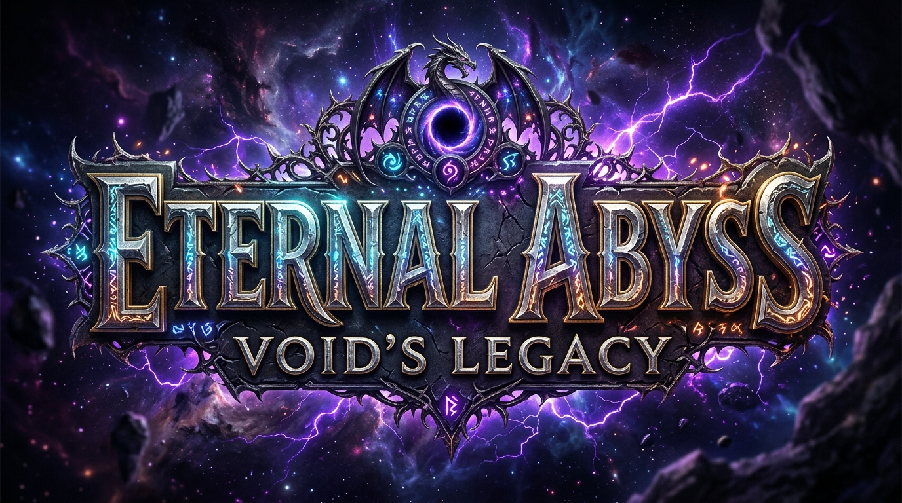

# ⚔️ Vực Thẳm Vĩnh Cửu: Di Sản Hư Không (Eternal Abyss: Void's Legacy)



Game nhập vai hành động chặt chém ARPG tiêu diệt Boss hư không vô tận được xây dựng trên nền tảng **Godot Engine 4.7** kết hợp hệ thống Server Backend Node.js đồng bộ dữ liệu đám mây và Bảng xếp hạng đỉnh cao.

---

## 🎮 Tải Về & Chơi Game (Bản Phát Hành v1.0.0)

👉 **[Tải Bản Cài Đặt Trọn Gói (.ZIP) Tại Mục Releases](https://github.com/VuNguyen76/Vuc-Tham-Vinh-Cuu/releases)**

### Cách Chơi:
1. Tải tệp `VucThamVinhCuu-v1.0.0-Windows-x64.zip` từ mục Releases về máy tính.
2. Giải nén thư mục zip.
3. Nhấp đúp vào tệp **`CHOI_GAME.bat`** để tự động khởi động server backend và vào game trải nghiệm ngay lập tức!

---

## ⚔️ Tính Năng Nổi Bật

### 1. Nhân Vật & Hệ Thống Chiến Đấu Linh Hoạt
- **Chuỗi đòn đánh 3 nhịp (3-hit Combo)**: Chém liên hoàn mượt mà, trúng đích hồi ngay **+15 MP/hit**, cho phép người chơi liên tục xả combo kỹ năng.
- **Hủy động tác (Animation Cancelling)**: Nhấn `Space` để lướt né chiêu tốc biến, ngắt ngay lập tức động tác thừa và nhận khung hình bất tử (i-frames).
- **Bộ 6 Kỹ Năng Uy Lực**:
  - `[1] / [Q] Toàn Phong (Whirlwind)`: Xoay kiếm quét sạch quái vật xung quanh và kéo địch lại gần.
  - `[2] / [E] Trảm Hồn (Void Piercer)`: Phóng luồng sóng hư không xuyên thấu theo hướng trỏ chuột.
  - `[3] / [R] Thần Kiếm (Starfall)`: Triệu hồi cự kiếm thiên giới giáng sấm sét kinh hoàng.
  - `[4] / [F] Thánh Khiên (Divine Aegis)`: Khiên thánh bất tử 3 giây, tự động hồi máu và phát nổ linh quang.
  - `[5] Lôi Phạt (Thunder Tempest)`: Sấm sét giáng đồng loạt lên toàn bộ kẻ địch trên sàn đấu.
  - `[Space] Lướt (Dodge Dash)`: Tốc biến né chiêu với dư ảnh lấp lánh (hồi chiêu cực nhanh 0.35s).

### 2. Trùm Cuối Khổng Lồ & Quái Vật Tầng Hầm
- **Cổ Thần Hư Không (Eternal Void Colossus)**: Boss chuyển động theo khung xương động (Procedural Rig) với cánh đập, mắt phát sáng, lõi hư không xoay tròn và biết nghiêng người ngắm dũng sĩ.
- **Chiêu thức uy lực & Decal cảnh báo sàn đấu**: Bão đạn hỗn loạn, Tia sáng hư không, Vực xoáy trọng lực, Vết chém không gian.
- **Cơ chế hồi phục công bằng**: Khi đánh boss tụt qua mốc 75%, 50%, 25% máu hoặc tiêu diệt quái phụ, các **Bình Máu Thánh (+250 HP)** sẽ rơi ra sàn đấu để người chơi nhặt hồi phục ngay.
- **Quái vật theo từng tầng**: Skeleton, Zombie, Goblin sát thủ, Orc cuồng nộ và Quỷ ngưu Minotaur.

### 3. Đồ Họa Nâng Cấp & Ánh Sáng Dynamic
- Hệ thống phát sáng kỳ ảo **Glow / Bloom (WorldEnvironment)** giúp chiêu thức sấm sét và năng lượng hư không rực sáng chuẩn game ARPG cao cấp.
- Ánh sáng động **PointLight2D** từ 4 ngọn đuốc dungeon và vầng sáng bảo hộ quanh dũng sĩ soi sáng từng viên đá rêu phong.
- Toàn bộ **22 ảnh vật phẩm chuẩn game RPG từ AI Web Generator** với nền trong suốt (PNG Transparent) sắc nét.

### 4. Hệ Thống Trang Bị, Lò Rèn & Server Backend
- **Túi Đồ & Lò Rèn [B]**: 20 ô chứa trang bị (Vũ khí, Giáp trụ, Bùa nhẫn, Đá cường hóa, Rương kho báu).
- **Cường hóa trang bị**: Nâng cấp vũ khí và giáp trụ lên tới cấp tối đa +10.
- **Mở Rương Kho Báu**: Rương Gỗ, Bạc, Vàng và Rương Thần Thoại với tỷ lệ rớt trang bị giá trị.
- **Server Backend (Node.js Port 8787)**: Tự động lưu tiến trình dũng sĩ, đồng bộ đám mây và Bảng Xếp Hạng Đỉnh Cao (Leaderboard).

---

## 🕹️ Bảng Phím Điều Khiển

| Phím | Chức Năng |
| :--- | :--- |
| **W, A, S, D** / Mũi tên | Di chuyển nhân vật 4 hướng |
| **Chuột Trái** / **[J]** | Trảm kích liên hoàn 3 đòn (Trúng đích hồi +15 MP) |
| **Chuột Phải** / **[1]** / **[Q]** | Kỹ năng [1] Toàn Phong (Whirlwind) |
| **[2]** / **[E]** | Kỹ năng [2] Trảm Hồn (Void Piercer) |
| **[3]** / **[R]** | Kỹ năng [3] Thần Kiếm (Starfall Ultimate) |
| **[4]** / **[F]** | Kỹ năng [4] Thánh Khiên (Divine Aegis) |
| **[5]** | Kỹ năng [5] Lôi Phạt (Thunder Tempest) |
| **[Space]** / **[Shift]** | Lướt né chiêu tốc biến (Kháng sát thương) |
| **[B]** | Mở Giao diện Túi Đồ, Lò Rèn & Bảng Xếp Hạng |
| **[Esc]** | Đóng cửa sổ / Thoát |

---

## 🏗️ Cấu Trúc Dự Án
```
d:\QVVC\
├── assets/             # Hình ảnh texture, sprite, icon RPG, font chữ
│   ├── characters/     # Spritesheet hiệp sĩ LPC (walk, slash, thrust, hurt, cast)
│   ├── monsters/       # Spritesheet quái vật (skeleton, zombie, goblin, orc, minotaur)
│   ├── icons/          # 22 icon vật phẩm RPG sắc nét (vũ khí, giáp, nhẫn, rương, bình máu)
│   ├── fx/             # Hiệu ứng chiêu thức (sấm sét, tia sáng, kiếm thần, lốc xoáy)
│   └── ui/             # Khung UI, thanh máu/mana, Logo game chính thức
├── scenes/             # Các màn chơi và scene Godot (.tscn)
│   ├── main.tscn       # Scene chính đấu trường, ánh sáng, quái vật, camera
│   ├── player.tscn     # Scene nhân vật dũng sĩ
│   ├── boss.tscn       # Scene boss Cổ Thần Hư Không
│   └── hud.tscn        # Giao diện HUD, Màn hình chờ, Balo, Lò Rèn
├── scripts/            # Mã nguồn logic GDScript (.gd)
│   ├── player.gd       # Điều khiển dũng sĩ, combo, 6 kỹ năng
│   ├── boss.gd         # Trí tuệ nhân tạo Boss, xoay chuyển chiêu thức
│   ├── items_database.gd # Bảng dữ liệu trang bị, công thức rèn đồ
│   └── network_manager.gd# Kết nối server backend Node.js
├── server/             # Server Backend Node.js (Port 8787)
│   ├── server.js       # API lưu điểm, Bảng xếp hạng, xác thực
│   └── data/           # Cơ sở dữ liệu JSON
├── CHOI_GAME.bat       # Trình khởi chạy 1-click cho người chơi
└── VucThamVinhCuu.exe  # File thực thi game độc lập
```

---
*Chúc các dũng sĩ chinh phục thành công Vực Thẳm Vĩnh Cửu!* ⚔️
